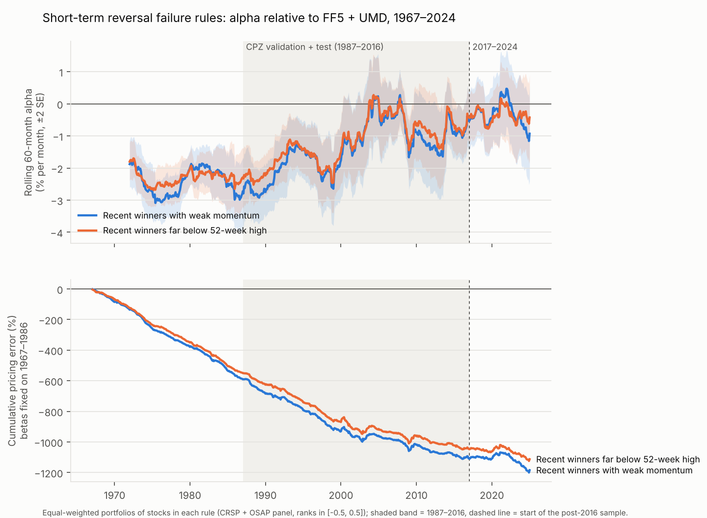

# Results on the extended CRSP + Open Source Asset Pricing panel (1967–2024)

This is a rebuild of the CPZ panel from CRSP and the Open Source Asset Pricing (OSAP) signals. It is
used for two things:
1. a **bridge check** against the CPZ results on the same 1967–2016 splits;
2. a **true out-of-sample test** on 2017–2024, after CPZ was first circulated in 2019.

CPZ-panel results: [cpz_results.md](cpz_results.md). Supporting tables: [`osap_results/`](osap_results/).

## Panel construction

`scripts/build_osap_panel.py` produces the same npz format as the CPZ data, with one extra split:

| split | months | stocks per month (median) | stocks in split |
|---|---|---|---|
| train | 1967–1986 (240) | 3,303 | 7,122 |
| valid | 1987–1991 (60) | 4,395 | 6,382 |
| test | 1992–2016 (300) | 4,379 | 14,179 |
| **post** | 2017–2024 (96) | 3,282 | 5,241 |

**Sources**
* **CRSP monthly file:** 1961–2024, common stocks on NYSE/AMEX/NASDAQ. Exported with
  `scripts/wrds_export_msf.sas`.
* **OSAP October 2025 release:** firm-level signals.
* **Welch–Goyal `Data2025.xlsx`:** macro series. All 33 stationary series with full 1967–2024 coverage
  are kept.
* **Ken French:** the risk-free rate.

**Timing.** Matched to the CPZ files and verified on them:
* row t holds the month-t excess return and characteristics known at the end of t−1;
* `ST_REV` is the month t−1 return, `r2_1` the month t−2 return;
* OSAP signals dated yyyymm enter row yyyymm + 1;
* macro series are lagged one month.

**Characteristics.** 42 of CPZ's 46:
* **from CRSP:** the six past-return characteristics, `LME`, turnover (`LTurnover`), a monthly
  volume-surprise proxy (`SUV`), and split-adjusted one-year share issuance (`NI`);
* **from OSAP:** the rest, mapped by economic category. The mapping is in `osap_results/build_meta.json`.
  Several mappings are approximate: `Resid_Var` ← IdioVolAHT, `D2A` ← depreciation/PPE,
  `OA` ← percent operating accruals, `CF2P` ← OSAP CF (cash flow to market), `CF` ← OSAP cfp;
* **no counterpart:** Q, SGA2S, FC2Y, PCM.

**Consistency with the CPZ characteristics.** `scripts/compare_cpz_osap_chars.py` compares the two panels
stock by stock over 1967–2016.
* **Matching.** The CPZ files have no stock identifiers, so stocks are matched within each month on the
  excess return. A match requires agreement to 1e-5 and a return that is unique in both panels. That
  matches 651,000 of CPZ's 1.22 million stock-months (53%). Most of the rest fail the uniqueness
  requirement or differ by a few 1e-5, from rounding or a slightly different
  risk-free rate. 97–98% of CPZ returns have an OSAP return within 1e-4.
* **Measure.** Both panels hold ranks over different universes, so each characteristic is compared by
  its monthly Spearman correlation on the matched stocks. Median-imputed OSAP cells are left out.
* **Table:** [`osap_results/char_consistency.csv`](osap_results/char_consistency.csv).

| agreement (mean monthly Spearman) | characteristics |
|---|---|
| ≥ 0.97 | the six past-return characteristics, LME, LTurnover, AT, OL, Beta |
| 0.80–0.91 | DPI2A, Investment, CTO, S2P, OP, Variance, ATO, MktBeta, A2ME, BEME, E2P, Resid_Var, ROE, Rel2High, PM, C |
| 0.60–0.80 | NOA, CF2P, RNA, PROF, D2P, Lev, Spread, SUV, IdioVol, ROA |
| < 0.60 | NI (0.53), AC (0.32), OA (0.21), CF (0.18), D2A (0.16) |

* **Two mapping errors, fixed.** The comparison found them in the first build:
  * `Beta` and `MktBeta` were swapped. CPZ's `Beta` matches OSAP BetaFP at 0.99; CPZ's `MktBeta`
    matches OSAP Beta at 0.86.
  * CPZ's `CF2P` matches OSAP's CF signal (0.78), not cfp (0.26).

  Both fixes only rename columns. `CF` and `CF2P` are both in the value group, and neither beta is in
  a group or on the friction list. So every fitted number in this document is unchanged; the tables in
  `osap_results/` and `robustness/osap_*` carry the corrected names.
* **The main findings rest on well-matched characteristics.**
  * The reversal rules use ST_REV and r12_2 (0.99) and Rel2High (0.83).
  * Value-group members agree at 0.78–0.90, except CF (0.18) and D2P (0.69).
  * Idiosyncratic volatility, identified in Paper 2 below, matches at 0.62 (IdioVol) and 0.83 (Resid_Var).
* **Five characteristics are different signals, not proxies:** NI, AC, OA, CF and D2A. Results naming
  them describe the OSAP signal, not CPZ's characteristic.
  * NI: CPZ's definition differs from split-adjusted one-year share growth.
  * The other four: OSAP's accruals, cash-flow and depreciation measures use other numerators or
    scalings.
  * Rebuilding them to CPZ's definitions would need Compustat annual data.
* **Spread is a different measure, and SUV is a monthly proxy.** CPZ's `Spread` agrees more with
  realized variance (0.83) than with OSAP's Corwin–Schultz BidAskSpread (0.65), so it is likely a
  daily-data measure. SUV is a monthly proxy for CPZ's daily volume surprise (0.65).

**Cross-validation against Jensen, Kelly & Pedersen (2023).** Where CPZ and OSAP disagree, the JKP data
from "Is there a replication crisis in finance?" serve as an independent third construction.
`scripts/compare_cpz_osap_jkp.py` does the three-way comparison:
* **Matching.** Stock-months matched between CPZ and OSAP on the return carry OSAP's permno, which joins
  JKP on permno and month. 98% of the JKP and OSAP excess returns agree to 1e-3, which confirms the join.
* **Sample.** 105,000 stock-months, every June and December of 1970–2016. JKP's extract starts in 1970.
* **Measure.** Mean monthly rank correlation with JKP's characteristic of the same definition. Where JKP
  has none, the closest JKP characteristic is used.
* **Tables:** [`osap_results/char_crossvalidation_jkp.csv`](osap_results/char_crossvalidation_jkp.csv)
  (per characteristic) and `char_crossvalidation_jkp_full.csv` (against all 405 JKP characteristics).

| finding | characteristic: ρ(CPZ, JKP) / ρ(OSAP, JKP), with JKP's version |
|---|---|
| all three agree (≥ 0.97) | past returns (except r2_1, which JKP lacks, and r12_7), LME, AT, Beta (the Frazzini–Pedersen beta) |
| **OSAP agrees with JKP, CPZ deviates** | IdioVol 0.62 / 0.99 (ivol_ff3_21d), Variance 0.88 / 1.00 (rvol_21d), Spread 0.66 / 1.00 (bidaskhl_21d), NI 0.48 / 1.00 (chcsho_12m), D2P 0.69 / 0.98, A2ME 0.83 / 0.98, S2P 0.88 / 0.98, PROF 0.65 / 0.93 (gp_at) |
| **CPZ agrees with JKP, OSAP deviates** | Rel2High 0.98 / 0.85 (prc_highprc_252d), Lev 0.88 / 0.66 (debt_be), PM 0.87 / 0.76 (ebit_sale), RNA 0.76 / 0.60 (ebit_bev), and less clearly MktBeta 0.98 / 0.88 (beta_60m) |
| agree within 0.10, moderate levels | BEME, C, E2P, ATO, CTO, OP, ROA, ROE, NOA, DPI2A, Resid_Var, LTurnover, OL |
| no source matches JKP | CF, CF2P, AC, OA, D2A, SUV, Investment (0.47 / 0.54 with at_gr1) |

* **Neither panel is uniformly "correct".**
  * For trading characteristics built from daily data, OSAP reproduces the standard construction almost
    exactly. CPZ's versions differ.
    * CPZ's `Spread` behaves like a volatility measure: 0.84 with 21-day return volatility, against 0.66
      with the Corwin–Schultz spread.
    * CPZ's `IdioVol` is closest to a one-year rather than a one-month idiosyncratic volatility (0.75).
    * CPZ's `NI` is not twelve-month share growth.
  * The lower agreement for CPZ's price-scaled ratios (A2ME, S2P, D2P) points to a different market-equity
    date in CPZ.
  * So where these OSAP characteristics differ from CPZ, it is CPZ that departs from the standard
    definition; OSAP is not wrong.
* **Four OSAP mappings depart from the standard and could be improved.**
  * `Rel2High`: OSAP's High52 is not the daily 52-week-high ratio. CPZ and JKP agree at 0.98. This
    characteristic enters the reversal rules.
  * `Lev`: OSAP's Leverage is market leverage (0.90 with JKP at_me), whereas CPZ's is book leverage. OSAP's
    BookLeverage signal would be closer.
  * `PM` and `RNA`: OSAP's PM and RetNOA are further from JKP's than CPZ's are.
* **Accounting characteristics agree only moderately everywhere (0.6–0.9).** JKP update accounting data
  with a shorter lag and use quarterly data where available, so timing differences cap these
  correlations. For accruals, cash flow, depreciation and investment, no two sources agree. JKP has no
  exact counterpart to CPZ's definitions, so only a Compustat rebuild (`scripts/wrds_export_funda.sas`)
  can settle them.
* **For this project.** OSAP replicates CPZ for the characteristics behind the main findings: ST_REV and
  r12_2 at 0.99, and the value measures at 0.79–0.98. Rel2High is the one exception, and there CPZ is
  the better-built panel. Since the reversal results hold on both panels, they do not hinge on it.

**Missing values.** Requiring every characteristic, as CPZ do, keeps only 17% of stock-months. OSAP's
`OperProf` covers about 40% of stocks, `EP` about 60%, and `Cash` and quarterly `roaq` start only in
1971–72. The main panel therefore follows Gu, Kelly & Xiu (2020): it keeps stock-months with at least
two-thirds of the characteristics observed and sets the missing ranks to the cross-sectional median.
That keeps 80% of stock-months. A complete-case version is in `datasets/osap_cc`, usable from 1972.

**Delisting returns.** Combined with RET; −30% for performance delistings with a missing delisting
return (Shumway 1997).

**Settings.** `config_glassbox/osap.json` (test 1992–2016) and `config_glassbox/osap_post.json` (test
2017–2024). Same training schedule as CPZ, 9 seeds per rung. State variables: dfy, tms, svar.
Audit state variables: dfy, tms, svar, tbl, d/p, ntis, infl, b/m. No neural rung (it overfit on CPZ),
and no CPZ GAN (its exact characteristics cannot be rebuilt, so it cannot be evaluated after 2016).

**Universe caveat.** This panel holds about twice as many stocks as CPZ's complete-case panel, mostly
smaller firms. Sharpe ratio levels are therefore higher and not directly comparable with the CPZ panel.
Compare orderings and failure patterns.

---

## Paper 1

### Complexity ladder (monthly Sharpe ratio)

| SDF | train | valid | test 1992–2016 | post 2017–2024 | CPZ panel test (for comparison) |
|---|---|---|---|---|---|
| linear | 1.09 | 2.06 | 0.89 | 0.41 | 0.46 |
| linear + state | 1.16 | 1.42 | 0.34 | 0.17 | 0.56 (Welch-Goyal set) |
| **additive** | 2.18 | 2.22 | **0.96** | **0.42** | 0.64 |
| additive + state | 2.05 | 1.16 | 0.49 | 0.17 | 0.63 (Welch-Goyal set) |
| additive + state + pairs | 2.09 | 1.06 | 0.48 | 0.15 | — |

* **Bridge, same ordering.** As on the CPZ panel, the static additive SDF is best out of sample. The
  state-varying rungs overfit: they fall from about 2 in training to about 0.5 in the test period.
  Unlike on the CPZ panel, the Welch-Goyal state set does not rescue them here.
* **After 2016, every SDF loses more than half its Sharpe ratio.** The additive SDF falls from 0.96 to
  0.42 and the linear SDF from 0.89 to 0.41. All weights were fixed in 1986, so this is genuinely out
  of sample. It is consistent with the post-publication decay of anomaly returns documented elsewhere,
  and in particular with the decline of short-term reversal (below).

### Audit

Discovery uses 1967–1986. Confirmation uses either 1987–2016 (bridge) or **2017–2024 alone** (post).

| SDF | bridge: max \|t\| (p) | post: max \|t\| (p) |
|---|---|---|
| linear | 3.7 (0.048) | 2.6 (0.37) |
| linear + state | 6.6 (< 0.001) | 3.0 (0.18) |
| additive | 5.0 (0.002) | **4.0 (0.013)** |
| additive + state | 7.3 (< 0.001) | 2.8 (0.22) |
| additive + state + pairs | 6.5 (< 0.001) | 2.7 (0.31) |
| CAPM | 9.6 (< 0.001) | 3.3 (0.09) |
| FF3 | 10.3 (< 0.001) | **4.2 (0.006)** |
| FF5 + UMD | 7.0 (< 0.001) | 3.0 (0.20) |

**Bridge (1987–2016): the CPZ-panel failure pattern reproduces.** The dominant confirmed failure is
again short-term reversal: recent winners with weak momentum or far below their 52-week high.

| model | hold-out t of the reversal rule |
|---|---|
| FF3 | −11.0 |
| CAPM | −9.6 |
| FF5 + UMD | −8.3 |
| linear + state | −5.1 |

FF3 also fails on the loser side: small recent losers have positive alpha (t ≈ 6.2–6.5). The static
additive glass-box SDF prices the reversal rule out of sample (t = −0.8) and confirms no failure.

**Post-sample (2017–2024 alone): much weaker.** With 96 months, power is lower.
* **Weaker reversal failure.** The rule's hold-out t falls to −1.4 for CAPM (not significant), −3.1 for
  FF3, −2.6 for FF5 + UMD and −2.0 for linear + state.
* **Most SDFs are no longer rejected.** FF5 + UMD (p = 0.20), CAPM (p = 0.09) and all state-varying
  glass-box SDFs (p ≥ 0.18) pass. The static additive SDF (p = 0.013) and FF3 (p = 0.006) are still
  rejected.

The reversal mispricing that dominated 1987–2016 is much weaker in 2017–2024. The next section shows
this is the tail of a gradual decline, not a 2017 break.

### The reversal rules' alpha over time



`scripts/plot_rule_alpha.py` tracks the two reversal rules' equal-weighted portfolios over 1967–2024,
against FF5 + UMD:
* **Top panel:** rolling 60-month alpha with ±2 SE bands.
* **Bottom panel:** cumulative pricing error with factor betas fixed on 1967–1986, so there is no
  look-ahead. The slope at any date is the alpha.

| rule | 1967–1986 | 1987–2016 | 2017–2024 |
|---|---|---|---|
| recent winners with weak momentum | −2.46% / month (t = −14.6) | −1.44% (t = −5.4) | −0.78% (t = −1.4) |
| recent winners far below 52-week high | −2.29% (t = −15.6) | −1.38% (t = −5.1) | −0.68% (t = −1.4) |

(Newey-West t-statistics; average 130–290 stocks per rule per month; tables in
`osap_results/rule_alpha_periods.csv`.)

* **A gradual decline, not a break.** The alpha shrinks steadily from about −2.5% a month in the 1970s
  and 1980s. It is near zero around 2003–2008 and about −0.5% to −1% a month since. The post-2016
  sample does not show a new regime: the alpha continues a three-decade decline, consistent with
  growing arbitrage capital and falling trading costs for short-term reversal strategies.
* **Not significant since 2017, but not shown to be zero.** The 2017–2024 alpha is still about −8% a
  year. With 96 months its t-statistic is only −1.4, so the data cannot tell a smaller negative alpha
  from zero. The audit's "no longer rejected" result for 2017–2024 is partly a power result.
* **Both rules behave almost identically.** They select overlapping stocks (recent winners with poor
  longer-term price performance). The failure is therefore one effect, recent-winner reversal among
  long-term losers, not two.

**Pooling caveat.** An earlier version of the post-sample audit pooled 1987–1991 with 2017–2024. That
gave reversal t-statistics of −4 to −6 and should not be used. `run_paper1.py --holdout test` now
confirms on the test split alone.

**Weight drivers** of the richest glass-box SDF: ST_REV × Investment interaction 0.085, then
investment (DPI2A), operating leverage, idiosyncratic volatility, share issuance and 52-week high, at
0.05–0.07 each.

---

## Paper 2 (additive SDF, 379 parameters)

* **Shrinkage.** The penalty chosen on validation is 0.001, giving validation SR 2.20 against 1.74
  unpenalized.
* **Fit.** Test SR (1992–2016) is 0.78. Across the ε = 1% Rashomon set it ranges from 0.65 to 0.80.

| feature | importance | identified (ε = 0.2% / 1% / 5% / bootstrap) | sign identified |
|---|---|---|---|
| **value (group)** | 0.20 | ✓ / ✓ / ✓ / ✓ | — |
| **short-term reversal** | 0.06 | ✓ / ✓ / ✗ / ✓ | at every ε and bootstrap (negative) |
| idiosyncratic volatility | 0.07 | ✓ / ✓ / ✗ / ✓ | ε = 0.2% and bootstrap (negative) |
| Resid_Var | 0.06 | ✓ / ✓ / ✗ / ✓ | — |
| cash flow to price (CF2P) | 0.06 | ✓ / ✓ / ✗ / ✗ | — |
| size (LME), assets (AT), ROA, NI | < 0.05 | partly | ε ≤ 1% and bootstrap |

* **The two CPZ-panel conclusions replicate:**
  * value is identified as a group but no single value measure is;
  * short-term reversal is the characteristic whose direction is identified everywhere.

  On this broader universe, idiosyncratic volatility joins them.
* **Most stock-level weights are not identified:** the weight sign is ambiguous for 82% of test
  stock-months at ε = 1%.
* **Ambiguity is not priced:** H − L alpha t = −0.31; Fama-MacBeth t = −0.92 with characteristic,
  squared-characteristic and SDF-weight controls. This again matches the CPZ panel.

---

## Robustness

Rule thresholds and knot counts: [robustness.md](robustness.md). On this panel the factor models'
reversal failure is confirmed under every rule grid (hold-out t from −7.8 to −11.1). The additive SDF
has no confirmed failure in four of five grids. Short-term reversal and the value group stay identified
with 5, 9 and 13 knots.

## Summary

* **Replicates on an independently built panel:**
  * short-term reversal is the main pricing failure of the factor models and the robustly identified
    characteristic of the glass-box SDF;
  * value is identified only as a theme;
  * state-varying characteristic prices do not help out of sample;
  * SDF ambiguity is not priced.
* **New after 2016:**
  * the SDFs lose more than half their Sharpe ratio;
  * the reversal failure weakens sharply;
  * most models are no longer rejected on 2017–2024 alone.

  The rule-level alphas over time show this is the continuation of a gradual decline since the early
  1990s rather than a post-2016 break. The 2017–2024 alpha is still about −8% a year but, with 96
  months, not statistically distinguishable from zero.

## Reproducing

```bash
python scripts/build_osap_panel.py --impute median --out datasets/osap        # needs the CRSP, OSAP and Goyal files
python scripts/download_ff_factors.py --config config_glassbox/osap.json --out datasets/factors/ff5_umd_osap.csv
python scripts/download_ff_factors.py --config config_glassbox/osap_post.json --out datasets/factors/ff5_umd_osap_post.csv
python scripts/run_paper1.py --config config_glassbox/osap.json --out results/paper1_osap --skip_neural
python scripts/run_paper1.py --config config_glassbox/osap_post.json --out results/paper1_osap_post_only --skip_neural --reuse results/paper1_osap --holdout test
python scripts/run_paper2.py --config config_glassbox/osap.json --out results/paper2_osap_additive --rung additive
python scripts/plot_rule_alpha.py --out docs/osap_results
```
